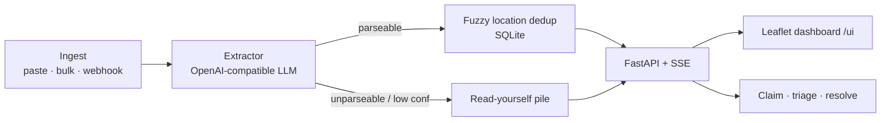

<div align="center">

# ReliefStream

### Real-time centralization of flood-rescue requests from social media chaos

*Ingest → LLM extract → dedup → map → claim. Ambiguous parses go to a human, never silently dropped.*


</div>

---

## Problem

During floods, rescue requests scatter across Twitter, WhatsApp forwards, and Instagram DMs. Volunteers spend more time **finding** requests than acting on them, and the same cry for help gets forwarded dozens of times while an untouched one across town waits. A confident wrong location from an LLM is worse than no answer — it sends a boat to the wrong street.

## Solution

ReliefStream is a single-screen dashboard that:

1. **Ingests** raw social / WhatsApp / SMS text (paste, bulk, or `POST /ingest`)
2. **Extracts** structured fields via any OpenAI-compatible LLM (Ollama / Groq / OpenRouter / Gemini)
3. **Deduplicates** with normalised + fuzzy location matching (Jaccard/containment/Latin-fold)
4. **Maps** actionable requests on Leaflet; volunteers claim / resolve
5. **Escalates failures** — low-confidence or incomplete parses land in a **"Read yourself"** pile

---

## Architecture



**Design decisions / trade-offs**

| Decision | Why | Trade-off |
|---|---|---|
| Refuse to mark `parseable` without location + urgency + type + confidence ≥ 0.4 | Wrong pin > no pin during a flood | More items in the human pile |
| OpenAI-compatible client (not a vendor SDK) | Swap Ollama ↔ Groq ↔ OpenRouter with env vars | No vendor-specific tool calling |
| SQLite + in-process SSE | Zero-ops local / single-container deploy | Scale-out needs Postgres + Redis (documented) |
| Fuzzy location dedup (norm + Jaccard/containment) | Collapses WhatsApp forwards despite LLM wording drift | Near-identical streets (e.g. GRD vs Hope College) can still collide |

---

## Results (measured)

Eval set: 41 labelled messages in [`eval/labeled_messages.jsonl`](eval/labeled_messages.jsonl).  
Model measured here: **Qwen2.5-1.5B-Instruct Q4_K_M** via `llama.cpp` `llama-server` (CPU). Re-run with your production model to refresh the table — see [`eval/README.md`](eval/README.md).

| Metric | Value |
|---|---|
| Extraction micro-F1 (5 fields) | **0.901** (P 0.893 / R 0.909) |
| Location F1 | 0.857 |
| Urgency F1 | 1.000 |
| Request-type F1 | 0.880 |
| People-count F1 | 0.872 |
| Contact F1 | 0.882 |
| Actionable classification F1 | **0.923** (acc 0.892) |
| Dedup pairwise F1 | **1.00** (P 1.00 / R **1.00**; was P 1.00 / R 0.545 / F1 0.706 with exact fingerprint) |
| Latency mean / p50 / p95 | 8.76 s / 7.20 s / 21.4 s (CPU, 1.5B Q4) |

Dedup now uses location normalisation + fuzzy matching (token Jaccard, ≥3-token containment, Latin-only fold for Tamil/English pairs, soft type pairs). Measured on the same 41-message set with a **cluster-level holdout** (dev = first half of clusters for matcher design; test = second half, evaluated once): holdout-test P=R=F1=**1.00**. Full-set before→after recall **0.545 → 1.00** (exact fingerprint → fuzzy; qwen2.5:1.5b extractions). See `eval/results/dedup_before_after.json`.

Full JSON: [`eval/results/summary.json`](eval/results/summary.json).

---

## Quickstart

```bash
# backend
cd backend && python -m venv .venv && source .venv/bin/activate
pip install -r requirements.txt
cp .env.example .env          # point LLM_* at Ollama / Groq / …
uvicorn main:app --reload --port 8000

# frontend (dev) — or just open http://localhost:8000/ui when using Docker
cd frontend && python -m http.server 8080
```

```bash
# tests + eval harness (no LLM needed for unit tests / --mode gold)
pip install -r backend/requirements.txt pytest httpx
pytest -q
python eval/run_eval.py --mode gold
```

### Docker

```bash
docker compose up -d
docker compose exec ollama ollama pull qwen2.5:7b   # first run
# dashboard: http://localhost:8000/ui
```

### Deploy (not deployed from this PR — no cloud credentials)

- **Render:** [`render.yaml`](render.yaml) blueprint; set `LLM_API_KEY` as a secret (Groq / OpenRouter).
- **Fly.io:** [`fly.toml`](fly.toml) — `fly launch --no-deploy && fly secrets set LLM_API_KEY=… && fly deploy`.
- **Cloud Run:** step-by-step in [`deploy/cloudrun.md`](deploy/cloudrun.md).

All three serve the API + dashboard at `/ui` and expose `/healthz`.

---

## API surface

| Method | Path | Purpose |
|---|---|---|
| POST | `/ingest`, `/ingest/bulk` | extract + upsert |
| GET | `/requests`, `/requests/{id}` | list / detail |
| POST | `/requests/{id}/claim\|triage\|resolve` | workflow |
| GET | `/stats`, `/stream` | counts + SSE |
| GET | `/healthz` | liveness |
| GET | `/ui` | static dashboard |

---

## CI

Workflow template: [`ci/github-actions.yml`](ci/github-actions.yml). Copy to `.github/workflows/ci.yml` on `main` (this PR's token lacked the `workflow` scope, so the file cannot live under `.github/workflows/` yet).

## Tech stack

FastAPI · Pydantic · SQLite · OpenAI-compatible LLM (Ollama / Groq / OpenRouter / Gemini) · Leaflet · SSE · Docker · pytest

---

## License

MIT. Built for Code for Communities 2026.
